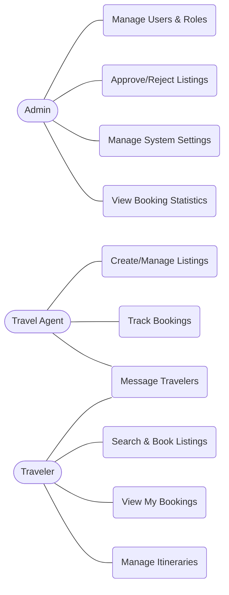
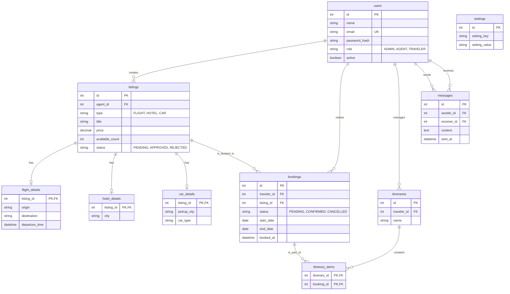
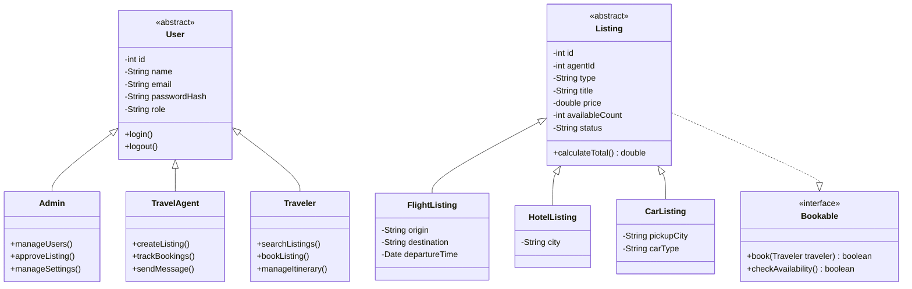
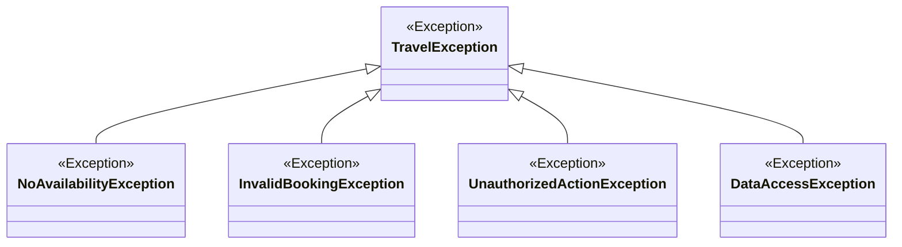

# 1. Online Travel Booking Platform
A comprehensive web-based platform to facilitate seamless travel arrangements connecting travelers and agents.
*Java Programming Project, Review 1 (Topic 32)*

## 2. Team ThiccStack
| Member Name | Roll Number |
|---|---|
| Harshit Jha | 25SCSE1011116 |
| Anand Kumar Yadav | 25SCSE1010142 |
| Aryan Yadav | 25SCSE1010769 |
| Shibu Kumar | 25SCSE1011027 |

## 3. Overview and User Roles
The platform centralizes travel booking, allowing seamless interactions between three user types:

| Role | Description |
|---|---|
| Admin | Oversees the platform, manages system settings, and approves/rejects new listings submitted by agents. |
| Travel Agent | Creates and manages listings for hotels, flights, and cars, and monitors their pending/approved status. |
| Traveler | Browses approved listings, searches by keyword, makes bookings, and views booking history. |

## 4. Features
| Working Now | Planned for Review 2 |
|---|---|
| Secure Login & Registration | Complete integration of Flights and Cars searches |
| Role-based Dashboards (AuthFilter) | Custom Itineraries (bundling hotel + flight + car) |
| Hotel Listing Creation (Agent) | In-app Messaging System between travelers and agents |
| Listing Approval Workflow (Admin) | Full-featured analytics on Agent/Admin dashboards |
| Hotel Search & Booking (Traveler) | Broader JUnit test coverage |
| Database Transactions (Commit/Rollback) | Extra feature implementation |

## 5. Technology Stack
- Java 17
- Jakarta Servlets and JSP
- JDBC
- MySQL
- Maven
- Tomcat 10.1 via Cargo
- JUnit 5

## 6. Architecture
Browser ➔ Servlets and AuthFilter ➔ Services ➔ DAOs ➔ MySQL

## 7. Design Diagrams

### Use-Case Diagram


### Entity-Relationship Diagram


### Class Diagram (Users and Listings)


### Class Diagram (Exceptions)


## 8. Project Structure
```text
src/
├── main/
│   ├── java/com/travel/
│   │   ├── dao/          - Data Access Objects handling database operations
│   │   ├── exception/    - Custom domain exceptions
│   │   ├── filter/       - Servlet filters for role-based authentication
│   │   ├── model/        - Object-oriented entities and enums
│   │   ├── service/      - Core business logic and transaction management
│   │   ├── servlet/      - HTTP request controllers
│   │   └── util/         - Utility classes (DBConnection, Password hashing)
│   ├── resources/
│   │   ├── db/           - Database schema and seed files
│   │   └── db.properties - Database configuration
│   └── webapp/
│       ├── admin/        - JSPs for Admin views
│       ├── agent/        - JSPs for Agent views
│       ├── css/          - Stylesheets
│       ├── traveler/     - JSPs for Traveler views
│       └── WEB-INF/      - Configuration (web.xml) and common JSPs
└── test/
    └── java/com/travel/  - JUnit 5 test classes
```

## 9. Java Concepts Used
| Concept | Classes / Files |
|---|---|
| Object-Oriented Programming (OOP) | `User.java`, `Traveler.java`, `Listing.java` |
| Collections Framework | `ListingDao.java` |
| Multithreading | `BookingService.java` |
| JDBC Transactions (Commit/Rollback) | `BookingService.java` |
| Servlets (Sessions & Role Filter) | `AuthFilter.java`, `LoginServlet.java`, `BookingServlet.java` |

## 10. Database
The application uses a relational schema.

**Tables:** `users`, `settings`, `listings`, `flight_details`, `hotel_details`, `car_details`, `bookings`, `itineraries`, `itinerary_items`, `messages`.

**Creation:**
Execute `schema.sql` to generate the table structure. 
Execute `seed.sql` to populate initial mock data.

## 11. Setup and Run
1. Install JDK 17, Maven, and MySQL.
2. In your MySQL instance, load the database structure and initial data:
   - Run `src/main/resources/db/schema.sql`
   - Run `src/main/resources/db/seed.sql`
3. Navigate to `src/main/resources/` and copy `db.properties.example` to create a new file named `db.properties`. Enter your own MySQL connection details.
4. Run the application from the root directory:
   ```bash
   mvn clean package cargo:run
   ```
5. Open your browser and navigate to `http://localhost:8080/travel-booking-platform/login`.

**Note:** The seed users provided in `seed.sql` do not have working passwords. To try each role:
- Register a new account on the site (new accounts default to Travelers).
- Promote one account to AGENT and another to ADMIN using an SQL statement in your database:
  `UPDATE users SET role='AGENT' WHERE email='your_email';`
  `UPDATE users SET role='ADMIN' WHERE email='another_email';`

## 12. How to Demo
1. Log in as an Agent. Add a new hotel (it will appear as PENDING).
2. Log out and log in as an Admin. Approve the new hotel listing.
3. Log out and log in as a Traveler. Search for the hotel, click book, and view the confirmed booking.

## 13. Tests
Run the JUnit 5 test suite using Maven:
```bash
mvn test
```
The tests cover DAOs checking database retrieval correctness, and Services checking business logic.

## 14. Review 1 Marking Criteria Mapping
| Marking Criterion | Satisfying Files / Classes |
|---|---|
| Problem Understanding and Solution Design | `User.java`, `Listing.java`, `docs/design.md` |
| Core Java Concepts | `Traveler.java`, `BookingService.java`, `ListingDao.java` |
| Database Integration | `BookingService.java`, `ListingDao.java`, `DBConnection.java` |
| Servlets and Web Integration | `LoginServlet.java`, `AuthFilter.java`, `LogoutServlet.java` |

## 15. Planned Next (Review 2)
- flights
- cars
- itineraries
- messaging
- full dashboards
- more tests
- extra feature
