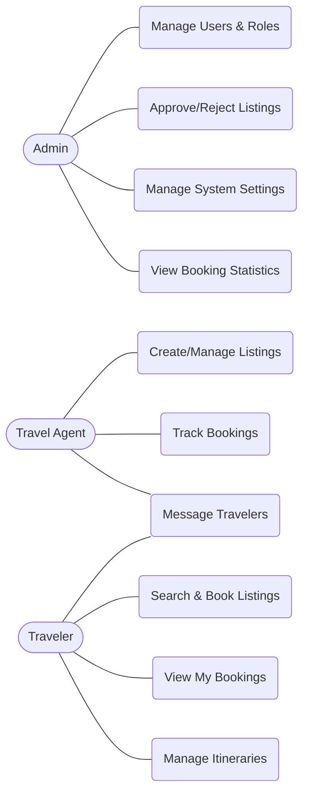
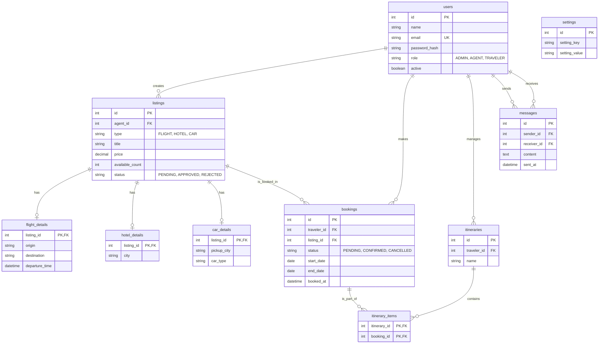
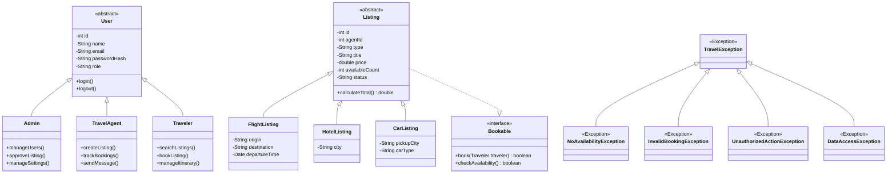

# Travel Booking Platform - Design Document

## 1. Functional Requirements

**Admin**
1. Manage users and roles across the platform.
2. Approve or reject new listings submitted by Travel Agents.
3. Manage global system settings.
4. View booking statistics and track pending approvals.

**Travel Agent**
1. Create, update, and manage listings for flights, hotels, and rental cars.
2. Send and receive messages with travelers.
3. Track bookings associated with their managed listings.

**Traveler**
1. Search the platform and book available flights, hotels, and rental cars.
2. View "My Bookings" with real-time status (confirmed or pending).
3. View and manage personal travel itineraries.
4. Send and receive messages with Travel Agents.

---

## 2. Use-Case Diagram

---

## 3. Entity-Relationship (ER) Diagram

---

## 4. Class Diagram

---

## 5. Layered Architecture

1. **Servlet (Controller):** Handles HTTP requests (GET/POST), reads parameters, manages the user Session, calls the Service layer, and forwards data to JSPs.
2. **Service (Business Logic):** Contains core business rules, handles custom exceptions, manages transactions, and deals with multithreading if required.
3. **DAO (Data Access Object):** Executes SQL queries using JDBC `PreparedStatement`, handles result sets, and abstracts away database specifics.
4. **Database (MySQL):** The persistence layer maintaining data integrity and relations.
